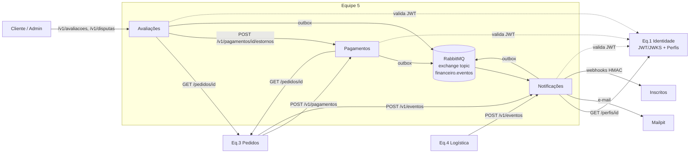

# Equipe 5 — Financeiro e Pós: Especificação de Design

- **Data:** 2026-10-14
- **Status:** aguardando revisão
- **Escopo:** serviços Pagamentos, Notificações e Avaliações da Plataforma de Delivery (Integração de Sistemas — UPE Garanhuns)
- **Fontes:** `Plataforma de Delivery - Arquitetura de Integração V4.md`, ementa da disciplina, aulas 01–08 e temas de seminário do repositório `integracao-de-sistemas`

---

## 1. Objetivo e critérios de sucesso

Entregar os 3 serviços da Equipe 5 com qualidade de nível sênior, demonstrando as práticas ensinadas na disciplina sem adicionar tecnologia que não resolva um problema real dos nossos serviços.

O projeto está pronto quando:

1. O fluxo **pedido criado → pagamento → notificação → entrega → avaliação/disputa → estorno → notificação** funciona ponta a ponta, contra os serviços reais das outras equipes ou contra os mocks.
2. Os logs do terminal e o Jaeger provam a integração entre os serviços, com `correlation_id` em toda linha.
3. Cada serviço tem OpenAPI (HTTP) e AsyncAPI (eventos) publicados, com cobertura de testes ≥ 75% garantida pelo CI.
4. Tudo sobe localmente com `docker compose up -d --build`.
5. O sistema está **acessível pela Internet** com HTTPS, e cada merge na `main` faz deploy automático.
6. O repositório contém: README com inventário de serviços, guia de integração para as outras equipes, diagramas, ADRs e coleção Postman (ambientes local e produção).

### Requisitos herdados

| Origem | Requisito |
|---|---|
| Documento V4 | Banco por serviço, sem JOIN entre equipes; portas distintas; erro `{"erro": true, "mensagem": "..."}` + status HTTP correto; datas ISO 8601; valores em centavos inteiros; Swagger; Dockerfile + compose; cobertura ≥ 75%; resiliência a queda de outras equipes; integração visível nos logs |
| Aula 01 (entregáveis do projeto) | Acessível pela Internet; repositório com documentação; diagramas e artefatos; URLs, endpoints, coleção Postman, Swagger; pipeline CI/CD; apresentação de decisões arquiteturais e trade-offs |
| Ementa | Princípios de orientação a serviço, camadas de serviço, API e contratos, orquestração, segurança e governança |
| Aulas 03–07 | Timeout em toda chamada; idempotência; REST com substantivos no plural; mensageria com ack manual; consumidor idempotente; adapter; compensação; regra de negócio no serviço dono |

### Fora do escopo (justificado em ADR)

API Gateway, rate limiting, service mesh, gRPC, GraphQL, serverless, Kafka, CDC/Debezium, CQRS/event sourcing, Prometheus/Grafana, Kubernetes em produção e Terraform.

---

## 2. Stack

| Camada | Escolha |
|---|---|
| Linguagem | Python 3.12 |
| HTTP | FastAPI + Pydantic v2 + uvicorn |
| Persistência | PostgreSQL 16 (alpine), SQLAlchemy 2.0 async + asyncpg, Alembic |
| Mensageria | RabbitMQ 4 (management), FastStream (gera AsyncAPI) |
| Cliente HTTP | httpx async + tenacity (retry) + circuit breaker próprio |
| Logs e traces | structlog (JSON em produção, console no desenvolvimento), OpenTelemetry → Jaeger |
| Testes | pytest, pytest-asyncio, pytest-cov, testcontainers, respx, schemathesis, Newman |
| Ferramental | uv (workspace), ruff, mypy `--strict`, pre-commit |
| Infraestrutura | Docker (multi-stage, não-root), Docker Compose, Caddy (HTTPS), Mailpit, GitHub Actions, GHCR, VM Azure for Students (B2s, Ubuntu 24.04) |

**Justificativa resumida:** é a stack dos exemplos da disciplina e da bibliografia (*Architecture Patterns with Python*). Os serviços fazem principalmente I/O, o que favorece async. A stack gera os contratos HTTP e de eventos automaticamente e cabe numa VM de 4 GB junto com toda a infraestrutura.

---

## 3. Arquitetura geral

### 3.1 Classificação dos serviços (camadas de serviço — Erl)

| Serviço | Camada | Porta local |
|---|---|---|
| Pagamentos | Entidade | 8013 |
| Notificações | Utilitário, agnóstico ao negócio e reutilizável por qualquer equipe | 8014 |
| Avaliações | Entidade (avaliações) + Tarefa (orquestração da disputa) | 8015 |

### 3.2 Mapa de integração



### 3.3 Princípios de comunicação

- **Síncrono (HTTP)** quando quem chama precisa da resposta para continuar. Exemplos: o resultado do pagamento para Pedidos; o estorno para a disputa.
- **Assíncrono (RabbitMQ)** para efeitos colaterais, como notificações e webhooks. Nada bloqueia esperando notificação.
- **Eventos de outras equipes entram por HTTP**, em `POST /v1/eventos` (Notificações). Esse endpoint funciona como adapter: grava o evento no outbox e o publica no broker. As outras equipes não precisam conhecer o RabbitMQ.
- **Exchange `financeiro.eventos` do tipo topic.** Cada consumidor faz bind só nas routing keys que lhe interessam. Mensagens que esgotam as tentativas vão para a DLQ.
- **Transactional Outbox:** todo serviço que publica eventos grava o evento na mesma transação da mudança de estado. Um relay publica depois, o que evita a escrita dupla inconsistente (banco atualizado, evento perdido).
- **Inbox:** todo consumidor grava o `mensagem_id` processado na mesma transação do efeito. Mensagem repetida é confirmada (ack) sem refazer o efeito.

### 3.4 Convenções de contrato (propostas à turma)

- **Rotas:** português, substantivos no plural, prefixo `/v1`. Ações são sub-recursos (`/estornos`) ou `PATCH` de status.
- **JSON:** campos em `snake_case`; datas ISO 8601 em UTC (`2026-10-14T14:30:00Z`); dinheiro em `*_centavos` (inteiro).
- **Erro:** `{"erro": true, "mensagem": "...", "codigo": "PAGAMENTO_RECUSADO", "correlation_id": "..."}`. Os campos `erro` e `mensagem` são os obrigatórios do V4; `codigo` e `correlation_id` são adicionais e não quebram consumidores.
- **Headers:**
  - `Authorization: Bearer <jwt>` em todas as rotas, exceto `/saude/*` e `/docs`.
  - `Idempotency-Key` obrigatório em `POST` com efeito financeiro (`/v1/pagamentos` e `/v1/pagamentos/{id}/estornos`).
  - `X-Correlation-ID` propagado em toda chamada e todo evento; gerado se ausente.
  - `traceparent` (W3C) propagado.
- **Paginação:** `?pagina=1&tamanho=20` (máximo 100). A resposta segue o formato `{"itens": [...], "pagina": 1, "tamanho": 20, "total": 57}`.

### 3.5 Envelope de evento (AsyncAPI)

```json
{
  "mensagem_id": "4f1c…-uuid",
  "tipo": "pagamento.aprovado",
  "versao": 1,
  "ocorrido_em": "2026-10-14T14:30:00Z",
  "correlation_id": "ab12…-uuid",
  "dados": { }
}
```

O `tipo` usa o formato `entidade.fato_no_passado` e é também a routing key.

| Tipo | Produtor | `dados` |
|---|---|---|
| `pagamento.aprovado` | Pagamentos | `pagamento_id, pedido_id, cliente_id, valor_centavos, metodo` |
| `pagamento.recusado` | Pagamentos | `pagamento_id, pedido_id, cliente_id, valor_centavos, motivo` |
| `pagamento.estornado` | Pagamentos | `pagamento_id, estorno_id, pedido_id, cliente_id, valor_centavos, motivo` |
| `avaliacao.registrada` | Avaliações | `avaliacao_id, pedido_id, restaurante_id, cliente_id, nota_restaurante, nota_entrega` |
| `disputa.aberta` | Avaliações | `disputa_id, pedido_id, cliente_id, motivo, valor_solicitado_centavos` |
| `disputa.resolvida` | Avaliações | `disputa_id, pedido_id, cliente_id, decisao, valor_estornado_centavos` |
| `disputa.estorno_falhou` | Avaliações | `disputa_id, pedido_id, motivo` |
| `pedido.*`, `entrega.*` | Eq. 3 / Eq. 4 via `POST /v1/eventos` | definido pela equipe produtora; validamos só o envelope |

Mudança incompatível nos `dados` exige incrementar `versao`. Consumidores ignoram campos desconhecidos.

### 3.6 Autenticação e autorização

- **O token é emitido pela Eq. 1.** Validamos localmente com a chave pública obtida do JWKS da Eq. 1, guardada em cache com TTL. Se a Eq. 1 não expuser JWKS, um adapter alternativo usa o endpoint de validação dela, também com cache. A escolha entre os dois fica atrás da porta `VerificadorDeToken`.
- **Claims usadas:** `sub` (id do usuário) e o papel do usuário (`cliente`, `loja`, `entregador`, `admin`). O nome exato da claim é mapeado no adapter.
- **Chamadas entre serviços dentro de uma requisição** repassam o token do usuário original.
- **Chamadas feitas por workers**, sem usuário na origem (ex.: a retentativa do estorno na saga), usam um **token de serviço interno da equipe**. É um JWT HS256 com `iss = "financeiro-eq5"` e papel `servico`, assinado com o segredo `TOKEN_SERVICO_SEGREDO`, compartilhado só entre os 3 serviços. O `VerificadorDeToken` aceita dois emissores: a Eq. 1 (JWKS) e esse emissor interno. O papel `servico` só é autorizado nas rotas que o declaram explicitamente; hoje, apenas `POST /v1/pagamentos/{id}/estornos` e `GET /v1/pagamentos`.
- **Chamadas dos nossos workers à Eq. 1** (`GET /perfis/{id}`) usam a credencial de serviço que a Eq. 1 fornecer (premissa na seção 12).

### 3.7 Estrutura do monorepo

```
delivery-financeiro/
├── pyproject.toml                 # workspace uv
├── compose.yaml                   # ambiente local (+ profile "mocks")
├── libs/plataforma/               # só código técnico transversal, sem domínio
│   └── erros, correlation, logging, envelope, outbox, inbox, circuit_breaker, auth, saude
├── services/
│   ├── pagamentos/
│   │   ├── Dockerfile, alembic/, pyproject.toml
│   │   ├── src/pagamentos/
│   │   │   ├── dominio/           # entidades, regras, exceções de domínio (sem framework)
│   │   │   ├── aplicacao/         # casos de uso, portas (Protocols), unit of work
│   │   │   ├── adaptadores/
│   │   │   │   ├── http/          # rotas FastAPI, schemas Pydantic
│   │   │   │   ├── db/            # modelos SQLAlchemy, repositórios
│   │   │   │   ├── mensageria/    # publicação/consumo FastStream
│   │   │   │   └── clientes/      # httpx para outras equipes
│   │   │   ├── api.py             # entrypoint "api"
│   │   │   └── worker.py          # entrypoint "worker"
│   │   └── tests/{unit,integracao,api}/
│   ├── notificacoes/ (mesma estrutura)
│   └── avaliacoes/   (mesma estrutura)
├── mocks/                         # stubs FastAPI: identidade, pedidos, logistica
├── infra/                         # compose.prod.yaml, Caddyfile, cloud-init
├── k8s/                           # bônus: manifests por serviço
└── docs/
    ├── adr/  diagramas/  openapi/  asyncapi/  postman/
    └── guia-de-integracao.md
```

**Regra de dependência:** `dominio` não importa nada de `aplicacao` nem de `adaptadores`. `aplicacao` só depende de `dominio` e de portas. Os adaptadores implementam as portas. O código de produção do domínio é testável sem banco, broker ou rede.

O scaffold NestJS que existe hoje no repositório é descartado e substituído por esta estrutura.

---

## 4. Serviços

### 4.1 Pagamentos (entidade)

**Modelo**
- `Pagamento`: `id`, `pedido_id`, `cliente_id`, `valor_centavos`, `metodo` (`cartao_credito` | `pix`), `status`, `motivo_recusa`, `criado_em`, `atualizado_em`.
- `Estorno`: `id`, `pagamento_id`, `valor_centavos`, `motivo`, `criado_em`.
- `ChaveIdempotencia`: `chave`, `escopo` (rota), `hash_requisicao`, `status_resposta`, `corpo_resposta`, `criado_em`.

**Estados do pagamento**

```
aprovado ──estorno parcial──► parcialmente_estornado ──estorno do restante──► estornado
aprovado ──estorno total──► estornado
recusado (terminal)
```

**Endpoints**

| Método e rota | Sucesso | Erros |
|---|---|---|
| `POST /v1/pagamentos` | `201` pagamento aprovado | `409 PAGAMENTO_RECUSADO` (a tentativa é persistida, e o corpo traz `pagamento_id`), `409 PEDIDO_JA_PAGO`, `422 PEDIDO_INEXISTENTE`, `422 IDEMPOTENCY_KEY_REUTILIZADA`, `400 IDEMPOTENCY_KEY_AUSENTE`, `403` (pedido de outro cliente), `503 DEPENDENCIA_INDISPONIVEL` |
| `GET /v1/pagamentos/{id}` | `200` | `404` |
| `GET /v1/pagamentos?pedido_id=` | `200` lista paginada | — |
| `POST /v1/pagamentos/{id}/estornos` | `201` | `404`, `409 PAGAMENTO_NAO_ESTORNAVEL` (recusado ou totalmente estornado), `422 VALOR_EXCEDE_SALDO_ESTORNAVEL`, `400/422` de idempotência |
| `GET /v1/pagamentos/{id}/estornos` | `200` | `404` |

Corpo de `POST /v1/pagamentos`: `{"pedido_id": "...", "metodo": "cartao_credito", "cartao": {"numero": "4111111111110000", "titular": "...", "validade": "12/28", "cvv": "123"}}`. O bloco `cartao` é exigido só para cartão e **nunca é persistido nem logado**; guardamos apenas os 4 últimos dígitos.

Corpo de `POST /v1/pagamentos/{id}/estornos`: `{"valor_centavos": 1000, "motivo": "..."}`. Se `valor_centavos` vier ausente, o estorno é do saldo estornável inteiro.

**Regras**
1. O valor é obtido de `GET {PEDIDOS_URL}/pedidos/{pedido_id}` (Eq. 3). Não existe campo de valor no corpo da requisição.
2. Com papel `cliente`, o pedido precisa pertencer ao `sub` do token.
3. Só é permitido um pagamento `aprovado` por pedido.
4. Valor acima de 500000 centavos (R$ 5.000) é recusado com `motivo = "analise_antifraude"`. Essa é uma regra de negócio que pertence a este serviço.
5. **Gateway simulado**, atrás da porta `GatewayDePagamento`, decidindo pelos 4 últimos dígitos do cartão:
   - `0000` → aprovado
   - `0002` → recusado (`saldo_insuficiente`)
   - `0119` → timeout, tratado como `503` sem persistir aprovação
   - qualquer outro final → aprovado
   - Pix → aprovado
6. **Idempotência:**
   - mesma chave com o mesmo hash de corpo devolve a resposta gravada, com o mesmo status;
   - mesma chave com corpo diferente devolve `422`;
   - a chave vale por 24 h.
   - A chave é registrada **antes** do processamento, com estado `em_processamento`, numa transação própria protegida por constraint única. Uma requisição concorrente com a mesma chave recebe `409 IDEMPOTENCY_EM_PROCESSAMENTO`.
   - Respostas `5xx` **não** são gravadas: o registro da chave é removido e o cliente pode repetir com a mesma chave.
7. Eventos publicados via outbox: `pagamento.aprovado`, `pagamento.recusado` e `pagamento.estornado`.

**Worker:** relay do outbox.

### 4.2 Notificações (utilitário)

**Modelo**
- `Notificacao`: `id`, `mensagem_id_origem`, `tipo_evento`, `canal` (`email` | `webhook`), `destino`, `status` (`pendente` | `enviada` | `falhou`), `tentativas`, `ultimo_erro`, `criado_em`, `enviada_em`.
- `AssinaturaWebhook`: `id`, `url`, `eventos` (lista de padrões, ex.: `pagamento.*`), `segredo` (cifrado em repouso), `ativa`, `criado_por`, `criado_em`.
- `EntregaWebhook`: `id`, `assinatura_id`, `mensagem_id`, `tentativa`, `status_http`, `duracao_ms`, `erro`, `criado_em`.
- `MensagemProcessada` (inbox): `mensagem_id` (PK), `processada_em`.

**Endpoints**

| Método e rota | Sucesso | Erros |
|---|---|---|
| `POST /v1/eventos` | `202 Accepted` (também para duplicata já recebida) | `400` envelope inválido, `401` |
| `POST /v1/webhooks` | `201` (com o `segredo` exibido só nesta resposta) | `422` URL inválida (exige `https`, exceto em ambiente local) |
| `GET /v1/webhooks` | `200` (só as do `sub`; `admin` vê todas) | — |
| `DELETE /v1/webhooks/{id}` | `204` | `404`, `403` |
| `GET /v1/webhooks/{id}/entregas` | `200` paginado | `404`, `403` |
| `GET /v1/notificacoes?destinatario_id=` | `200` paginado | — |

**Consumidor (worker)**
1. Faz bind em `#` no exchange `financeiro.eventos`, fila `notificacoes.eventos` durable, ack manual após o commit.
2. Se o `mensagem_id` já está na inbox, faz ack e encerra.
3. **E-mail:** se existe template para o `tipo`, busca o e-mail do destinatário em `GET {IDENTIDADE_URL}/perfis/{cliente_id}` (com cache de 5 min) e envia via SMTP para o Mailpit. Tipos sem template não geram e-mail.
4. **Webhook:** para cada assinatura ativa cujo padrão casa com o `tipo`, enfileira uma entrega em `notificacoes.webhooks`.
5. A inbox e as notificações são gravadas na mesma transação; o ack vem depois do commit.

**Entrega de webhook**
- `POST` para a URL com o corpo do envelope e os headers:
  - `X-Assinatura: sha256=<HMAC-SHA256(segredo, "<timestamp>.<corpo>")>`
  - `X-Assinatura-Timestamp`
  - `X-Evento-Id`
  - `X-Evento-Tipo`
- **Sucesso** é qualquer `2xx` em até 5 s.
- **Falha** reenfileira na fila de retry correspondente: `notificacoes.webhooks.retry.{1..5}`, com TTL de 1 s, 5 s, 30 s, 2 min e 10 min, e dead-letter de volta para a fila principal.
- Depois da 5ª falha, a entrega fica com status `falhou` e a mensagem vai para `notificacoes.dlq`.
- **Falha ao buscar o perfil** (Eq. 1 fora): a mensagem segue o mesmo esquema de retry com TTL; não é perdida.

### 4.3 Avaliações (entidade + tarefa)

**Modelo**
- `Avaliacao`: `id`, `pedido_id` (único), `cliente_id`, `restaurante_id`, `nota_restaurante` (1–5), `nota_entrega` (1–5, opcional), `comentario` (≤ 1000 caracteres, opcional), `criado_em`.
- `Disputa`: `id`, `pedido_id`, `pagamento_id`, `cliente_id`, `motivo` (`item_faltando` | `pedido_errado` | `nao_entregue` | `qualidade`), `descricao`, `valor_solicitado_centavos`, `valor_aprovado_centavos`, `status`, `parecer`, `estorno_id`, `tentativas_estorno`, `criado_em`, `atualizado_em`.

**Estados da disputa**

```
aberta ──PATCH improcedente──► improcedente (terminal)
aberta ──PATCH procedente──► estorno_pendente ──estorno ok──► resolvida (terminal)
                                     │
                                     └──recusa definitiva──► estorno_falhou (terminal; admin é notificado)
```

**Endpoints**

| Método e rota | Sucesso | Erros |
|---|---|---|
| `POST /v1/avaliacoes` | `201` | `409 AVALIACAO_DUPLICADA`, `422 PEDIDO_NAO_ENTREGUE`, `403` (pedido de outro cliente), `503` |
| `GET /v1/avaliacoes?restaurante_id=&pedido_id=` | `200` paginado | — |
| `GET /v1/avaliacoes/{id}` | `200` | `404` |
| `GET /v1/resumos-avaliacoes/{restaurante_id}` | `200 {"restaurante_id", "media_restaurante", "media_entrega", "total"}` | — |
| `POST /v1/disputas` | `201` | `422 PAGAMENTO_NAO_ENCONTRADO`, `409 DISPUTA_JA_ABERTA`, `422 VALOR_EXCEDE_PAGO`, `403`, `503` |
| `GET /v1/disputas?status=` | `200` paginado (o `cliente` vê só as suas) | — |
| `GET /v1/disputas/{id}` | `200` | `404`, `403` |
| `PATCH /v1/disputas/{id}` | `200` (resolvida ou improcedente) ou `202` (estorno pendente) | `403` (não-admin), `409 TRANSICAO_INVALIDA`, `422` |

**Regras**
1. Para avaliar, o pedido precisa estar com status de entregue, segundo `GET {PEDIDOS_URL}/pedidos/{id}`, e o `cliente_id` do pedido precisa ser igual ao `sub` do token. O `restaurante_id` é copiado do pedido.
2. Só uma avaliação por pedido.
3. Para abrir disputa, é preciso existir um pagamento `aprovado` ou `parcialmente_estornado` do pedido, segundo `GET {PAGAMENTOS_URL}/v1/pagamentos?pedido_id=`. Só uma disputa não-terminal por pedido. `valor_solicitado_centavos` não pode passar do valor pago.
4. O `PATCH` exige papel `admin`. O corpo é `{"status": "procedente" | "improcedente", "valor_aprovado_centavos": ..., "parecer": "..."}`. Se `valor_aprovado_centavos` vier ausente, usa-se o valor solicitado.
5. **Eventos via outbox:**
   - `avaliacao.registrada` ao criar uma avaliação;
   - `disputa.aberta` ao criar uma disputa;
   - `disputa.resolvida` ao chegar em `resolvida` (`decisao = "procedente"`) ou em `improcedente` (`decisao = "improcedente"`, `valor_estornado_centavos = 0`);
   - `disputa.estorno_falhou` ao chegar em `estorno_falhou`.

**Saga de disputa procedente (orquestração)**
1. Status `estorno_pendente`, com commit.
2. Chama `POST {PAGAMENTOS_URL}/v1/pagamentos/{pagamento_id}/estornos` com `Idempotency-Key: disputa-{disputa_id}`.
3. **Sucesso:** status `resolvida`, grava `estorno_id` e coloca `disputa.resolvida` no outbox. Resposta `200`.
4. **Falha transitória** (timeout, 5xx ou circuito aberto): mantém `estorno_pendente` e responde `202`. O worker refaz a chamada com backoff, até 10 tentativas. Repetir é seguro porque a chave de idempotência é fixa.
5. **Falha definitiva** (4xx de Pagamentos ou tentativas esgotadas): status `estorno_falhou` e `disputa.estorno_falhou` no outbox.

**Worker:** relay do outbox e retentativa da saga.

---

## 5. Resiliência

| Mecanismo | Especificação |
|---|---|
| Timeout | 1 s para conectar e 3 s para ler em todo cliente httpx, configurável (`HTTP_TIMEOUT_*`) |
| Retry | tenacity com até 3 tentativas, backoff exponencial e jitter, apenas em GET e em POST com `Idempotency-Key`; nunca em 4xx |
| Circuit breaker | um por dependência; abre após 5 falhas consecutivas; meio-aberto após 30 s; aberto → `503 DEPENDENCIA_INDISPONIVEL` imediato |
| JWKS | cache com TTL; se a Eq. 1 estiver fora, continua validando com a última chave conhecida |
| Broker fora | as APIs continuam operando; o outbox acumula; o relay publica ao reconectar |
| Exceções | handler global converte tudo para o formato de erro; `500` nunca expõe stack trace |
| Health | `GET /saude/vivo` (processo de pé) e `GET /saude/pronto` (banco + broker); a readiness não checa outras equipes |
| Shutdown | ao receber SIGTERM, o consumidor para de pegar mensagens e conclui as que estão em andamento |

---

## 6. Observabilidade

- **structlog:** JSON em produção, console colorido no desenvolvimento e na demo. Campos fixos: `servico`, `correlation_id`, `trace_id`, `nivel`, `evento`.
- **Logs de integração obrigatórios:**
  - toda chamada HTTP de saída gera uma linha antes e uma depois, com dependência, método, rota, status e duração;
  - todo evento publicado ou consumido gera uma linha com `tipo` e `mensagem_id`, e informa se a inbox o considerou novo ou duplicado.
- **Dados sensíveis:** número de cartão, CVV, token JWT e segredo de webhook nunca aparecem em log. Isso é garantido por um processor de redação no structlog e coberto por teste.
- **Correlation ID:** gerado por middleware se a requisição não trouxer um, propagado pelo httpx e gravado no envelope dos eventos.
- **OpenTelemetry:** instrumentação de FastAPI, httpx, SQLAlchemy e do cliente AMQP, exportando via OTLP para o Jaeger. O header `traceparent` é propagado também para as outras equipes.

---

## 7. Infraestrutura

### 7.1 Imagens e processos

- Um Dockerfile multi-stage por serviço:
  - estágio de build com a imagem do uv;
  - runtime `python:3.12-slim`;
  - usuário não-root;
  - `HEALTHCHECK` em `/saude/vivo`;
  - `CMD` em forma exec;
  - `.dockerignore`.
- Cada imagem tem dois comandos: `api` (uvicorn) e `worker`.
- O relay do outbox busca as mensagens com `SELECT … FOR UPDATE SKIP LOCKED` e é seguro com várias réplicas.
- O serviço `migrate-<servico>` roda `alembic upgrade head` uma vez. A `api` e o `worker` dependem dele com `condition: service_completed_successfully`.

### 7.2 Compose local (`compose.yaml`)

- **Serviços:**
  - `pagamentos`, `notificacoes` e `avaliacoes` (API, nas portas 8013, 8014 e 8015);
  - os três `*-worker` e os três `migrate-*`;
  - `db-pagamentos`, `db-notificacoes` e `db-avaliacoes` (Postgres 16-alpine, sem porta publicada, volume nomeado, healthcheck `pg_isready`);
  - `rabbitmq` (4-management, painel em 15672);
  - `mailpit` (interface em 8025);
  - `jaeger` (interface em 16686).
- O **profile `mocks`** sobe `mock-identidade`, `mock-pedidos` e `mock-logistica`. Os mocks emitem JWT de teste, expõem JWKS e pedidos com estados controláveis.
- Todas as dependências usam `condition: service_healthy`.
- URLs externas vêm de variáveis de ambiente (`IDENTIDADE_URL`, `PEDIDOS_URL`, `PAGAMENTOS_URL`, `JWKS_URL`).
- `.env.example` fica versionado e `.env` fica ignorado pelo git.

### 7.3 Produção

- **VM:** Azure for Students, B2s (2 vCPU, 4 GB), Ubuntu 24.04, provisionada por `infra/cloud-init.yaml` (instala Docker, cria usuário de deploy e configura o firewall). O NSG libera apenas 22, 80 e 443.
- **`infra/compose.prod.yaml`:** imagens `ghcr.io/<dono-do-repo>/<servico>:<sha-do-commit>` (valores preenchidos pelo pipeline), sem `build`, sem portas publicadas além das do Caddy.
- **Caddy:** HTTPS automático em `financeiro-eq5.<ip>.sslip.io`.
  - `/pagamentos/*`, `/notificacoes/*` e `/avaliacoes/*` → APIs. O FastAPI usa `root_path`, então cada Swagger fica em `/<servico>/docs`.
  - `/jaeger/*` e `/mailpit/*` exigem basic auth.
- Os segredos de produção ficam em GitHub Secrets e são gravados no `.env` da VM durante o deploy.

---

## 8. CI/CD (GitHub Actions)

**Fluxo de branches:** `feat/*`, `fix/*` etc. → PR para `dev` → PR para `main`.

| Gatilho | Jobs |
|---|---|
| PR (matriz por serviço, filtrada pelos caminhos alterados, sempre incluindo `libs/`) | `ruff check` + `ruff format --check` → `mypy --strict` → pytest (unit + integração com testcontainers + API) com `--cov-fail-under=75` → verificação de drift (o OpenAPI e o AsyncAPI gerados devem ser iguais aos de `docs/`) → `docker build` |
| PR (E2E) | `docker compose --profile mocks up` → schemathesis contra cada OpenAPI → Newman com a coleção Postman e o ambiente `ci` |
| Push na `main` | build + push para o GHCR (tag com o SHA) → deploy por SSH (grava o `.env`, `docker compose -f infra/compose.prod.yaml pull && up -d`) → smoke test em `/<servico>/saude/pronto` dos 3 serviços |

A meta interna de cobertura é 85%. O gate do CI fica em 75%, conforme o requisito.

---

## 9. Estratégia de testes

| Camada | Escopo | Ferramenta |
|---|---|---|
| Unitário | Entidades, transições de estado, regras (antifraude, saldo estornável, janela de idempotência, matching de padrões de webhook, HMAC, circuit breaker), casos de uso com repositório, UoW, gateway e clientes fakes | pytest |
| Integração | Repositórios e migrations no Postgres real; outbox e relay; inbox; consumidor e filas de retry no RabbitMQ real; clientes httpx (200, 404, 5xx, timeout, circuito aberto) | testcontainers, respx |
| API | Status, formato de erro, autenticação, `Idempotency-Key`, paginação, propagação de correlation id | httpx `AsyncClient` + `ASGITransport` |
| Contrato | Cada API contra o próprio OpenAPI | schemathesis |
| E2E | Fluxo da demo: pagamento aprovado → e-mail no Mailpit → webhook entregue → avaliação → disputa → estorno → e-mail | Newman (coleção Postman) |

Cenários de resiliência obrigatórios nos testes:
- Eq. 3 fora → `503`;
- gateway com timeout;
- repetição com a mesma `Idempotency-Key`;
- mensagem duplicada no consumidor;
- webhook falhando até a DLQ;
- Pagamentos fora durante a saga → `202` e conclusão posterior.

---

## 10. Documentação entregável

- **README raiz:**
  - visão geral;
  - inventário de serviços (capacidades, consumidores, porta, Swagger, AsyncAPI);
  - como rodar local e com mocks;
  - URLs de produção;
  - como rodar os testes.
- **`docs/guia-de-integracao.md`:** uma seção por equipe (1 a 4) com o que consumimos dela, o que ela pode consumir de nós, exemplos `curl` e o catálogo de eventos.
- **`docs/diagramas/`** (Mermaid):
  - C4 de contexto e de containers;
  - sequência do pagamento;
  - sequência da saga de disputa;
  - sequência da entrega de webhook com retry.
- **`docs/openapi/` e `docs/asyncapi/`:** contratos exportados e verificados no CI.
- **`docs/postman/`:** coleção e ambientes `local`, `ci` e `producao`.
- **`docs/adr/`** (formato MADR curto):
  1. Stack Python async
  2. Arquitetura hexagonal com Repository e Unit of Work
  3. Síncrono vs assíncrono e entrada de eventos externos via HTTP
  4. RabbitMQ com exchange topic, retry por TTL e DLQ
  5. Transactional Outbox e Inbox
  6. `Idempotency-Key` em operações financeiras
  7. `libs/plataforma` compartilhada sem domínio
  8. Validação de JWT via JWKS com cache
  9. Deploy em VM única com Compose vs PaaS
  10. Tecnologias avaliadas e não adotadas
- **`k8s/` (bônus):** Deployment, Service, ConfigMap, Secret e probes de liveness e readiness por serviço, validados num cluster kind. Não fazem parte da produção.

---

## 11. Fases de implementação

Cada fase gera o próprio plano de implementação.

1. **Fundação:**
   - workspace uv e `libs/plataforma`: erros, correlation, logging, envelope, outbox/inbox, circuit breaker, auth, saúde;
   - mocks;
   - `compose.yaml` com a infraestrutura;
   - CI (lint, tipos, testes, cobertura);
   - remoção do scaffold antigo.
2. **Pagamentos** completo, com testes e contratos.
3. **Notificações** completo: consumidor, e-mail, webhooks, `/v1/eventos`.
4. **Avaliações** completo: avaliações, disputas, saga.
5. **E2E e documentação:** schemathesis, coleção Postman e Newman no CI, diagramas, ADRs, guia de integração.
6. **Produção:** VM Azure, Caddy, `compose.prod.yaml`, CD.
7. **Bônus:** manifests k8s e validação no kind.

---

## 12. Premissas a validar com as outras equipes

| Premissa | Com quem | Plano se não se confirmar |
|---|---|---|
| A Eq. 1 expõe JWKS (ou um endpoint de validação) e um endpoint `GET /perfis/{id}` com e-mail | Eq. 1 | Adapter alternativo atrás da porta `VerificadorDeToken`; os mocks continuam valendo para demo e testes |
| A Eq. 1 fornece credencial de serviço (ex.: client credentials) para o worker de Notificações consultar perfis | Eq. 1 | O adapter `ClientePerfis` usa a credencial disponível; sem nenhuma, os e-mails só funcionam contra o mock, e isso fica documentado |
| A Eq. 3 expõe `GET /pedidos/{id}` com `cliente_id`, `restaurante_id`, valor total em centavos e status | Eq. 3 | O adapter `ClientePedidos` mapeia os nomes reais de campos e status |
| A Eq. 3 chama `POST /v1/pagamentos` no checkout e aceita `201`/`409` | Eq. 3 | Contrato publicado cedo no guia de integração |
| As Eq. 3 e 4 publicam `pedido.*` e `entrega.*` em `POST /v1/eventos` | Eq. 3 e 4 | É opcional para o fluxo principal: as regras de negócio consultam o estado por HTTP, e os eventos externos só alimentam notificações |
| Rotas em português, `snake_case` e formato de erro iguais em toda a turma | Turma | Proposta levada pela Equipe 5 |
