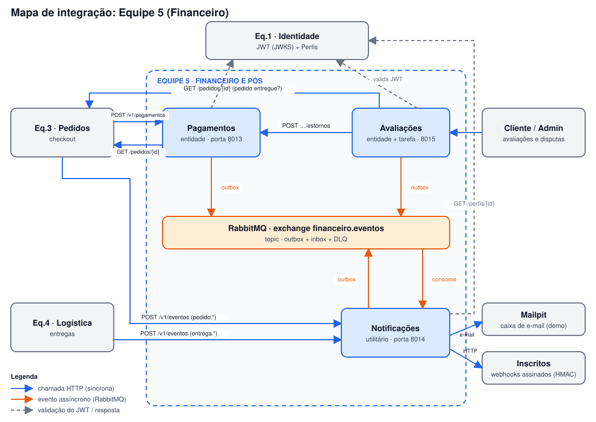
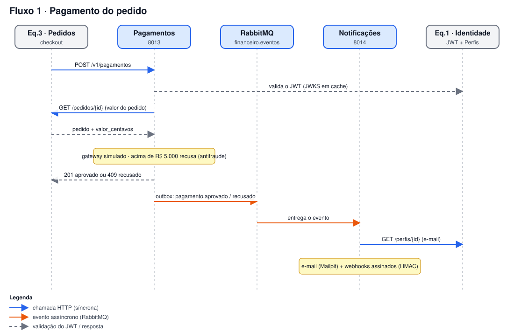
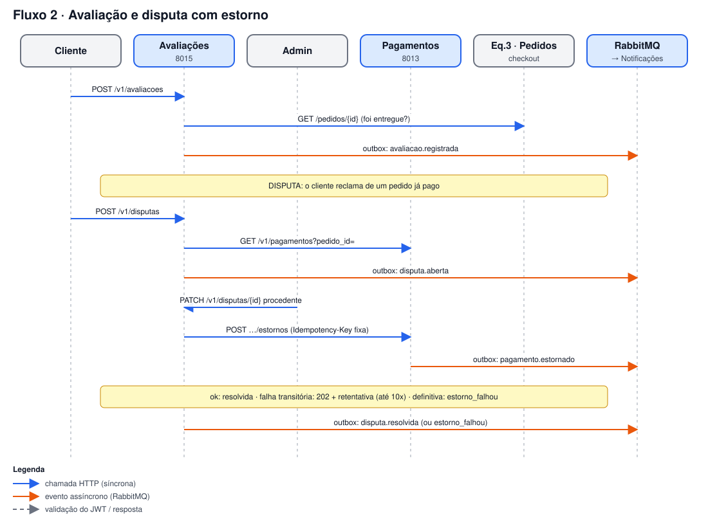

# Diagramas de fluxo

Visão geral de como a Equipe 5 (Financeiro) conversa com as outras equipes e entre os próprios serviços. A fonte de verdade é a [especificação](../arquitetura/especificacao.md); estes desenhos são um resumo visual.

## Mapa de integração

Quem chama quem, o que é HTTP síncrono, o que vai pelo RabbitMQ (outbox) e quem valida o JWT da Equipe 1.

## Fluxo 1: pagamento do pedido

A Equipe 3 pede o pagamento, Pagamentos consulta o pedido, decide no gateway simulado e publica o evento. Notificações consome o evento, busca o e-mail na Equipe 1 e avisa o cliente.

## Fluxo 2: avaliação e disputa com estorno

O cliente avalia um pedido entregue e pode abrir uma disputa. Se o admin der a disputa como procedente, Avaliações pede o estorno a Pagamentos (com chave de idempotência fixa, então repetir é seguro).

Cada diagrama também tem uma versão `.png`.
