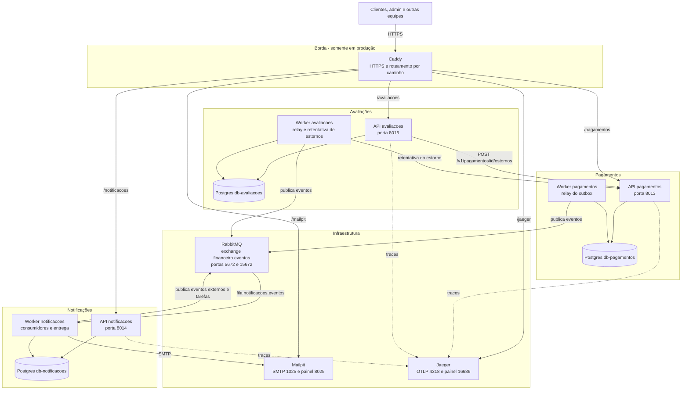

# C4: diagrama de containers

Os três serviços da Equipe 5 têm cada um uma API, um worker e um banco PostgreSQL próprio. Os eventos trafegam pelo exchange `financeiro.eventos` do RabbitMQ. Em produção, o Caddy é o único ponto de entrada (portas 80 e 443).

Localmente (`compose.yaml`) não há Caddy: as APIs, o RabbitMQ, o Mailpit e o Jaeger publicam suas portas direto no host.
