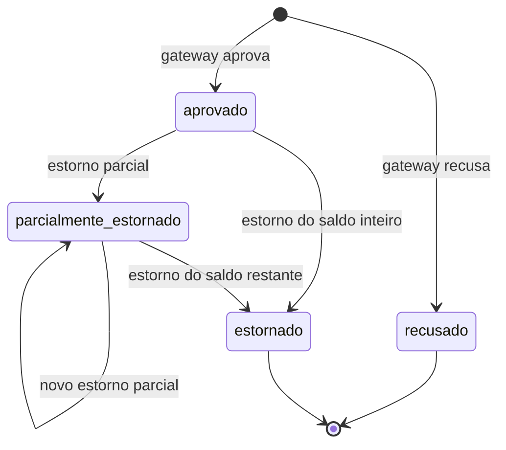
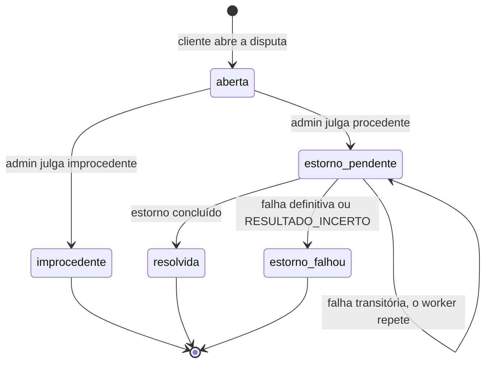

# Máquinas de estado

Estados do Pagamento (serviço Pagamentos) e da Disputa (serviço Avaliações), conforme `StatusPagamento` e `StatusDisputa` no código.

## Pagamento

Um pagamento nasce `aprovado` ou `recusado`. Só `aprovado` e `parcialmente_estornado` aceitam estorno. O pagamento vira `estornado` quando o estorno é igual ao saldo estornável.

## Disputa

A disputa nasce `aberta`. O admin a julga improcedente ou procedente. A procedente passa por `estorno_pendente` até o estorno em Pagamentos ser concluído ou falhar de vez.

