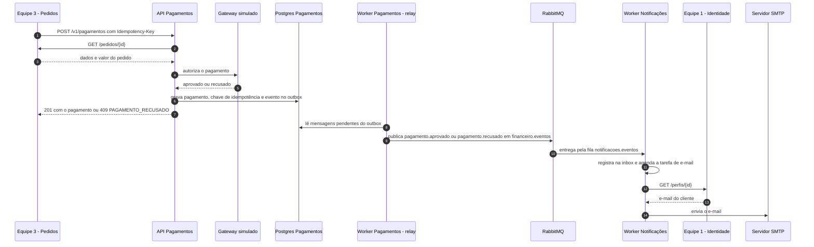

# Sequência: pagamento de um pedido

A Equipe 3 pede o pagamento com `Idempotency-Key`. Pagamentos confere o pedido, decide no gateway simulado e grava o resultado junto com o evento no outbox. O worker publica o evento, e Notificações o consome (inbox) e envia o e-mail.

Repetir a mesma `Idempotency-Key` com o mesmo corpo devolve a resposta gravada, sem cobrar duas vezes.
