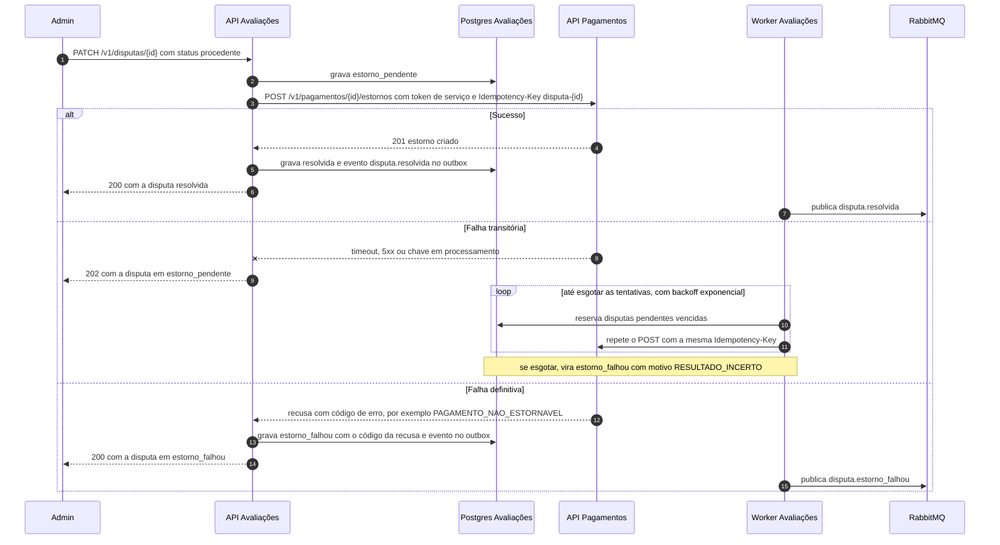

# Sequência: saga de estorno da disputa

O admin decide a disputa com `PATCH /v1/disputas/{id}`. Se for procedente, Avaliações grava `estorno_pendente` e pede o estorno a Pagamentos com token de serviço e `Idempotency-Key: disputa-{id}`. Repetir o pedido é seguro, e o resultado define o desfecho em um de três ramos.

Quando as tentativas se esgotam com falha transitória, o motivo é `RESULTADO_INCERTO`: o estorno pode ter sido feito em Pagamentos, e o admin deve conferir lá antes de agir. O evento `disputa.estorno_falhou` gera um e-mail de ação necessária ao admin.
