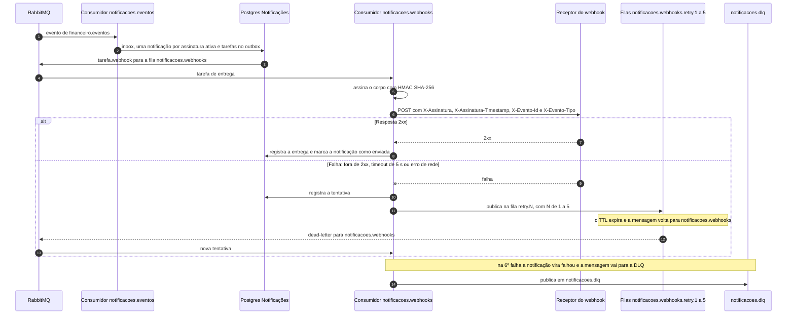

# Sequência: entrega de webhook

Notificações consome cada evento de `financeiro.eventos`, cria uma tarefa por assinatura ativa e entrega o POST assinado com HMAC. Falhas voltam pelas filas de retry com TTL crescente e, esgotadas as tentativas, vão para a DLQ.

Os TTLs padrão das filas de retry são 1 s, 5 s, 30 s, 2 min e 10 min. A entrega é pelo menos uma vez, então o receptor deve deduplicar por `X-Evento-Id`.
